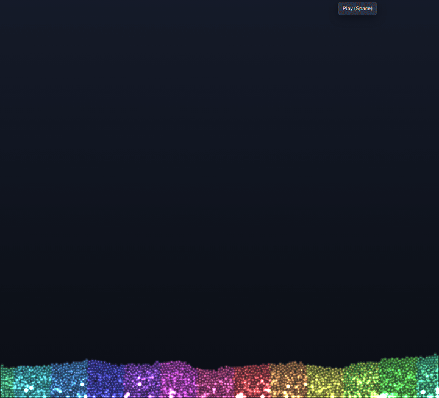
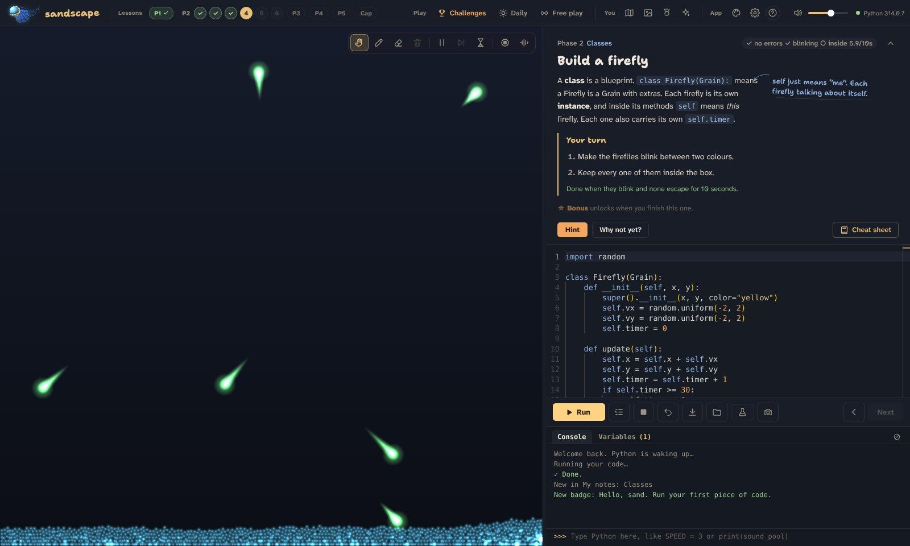
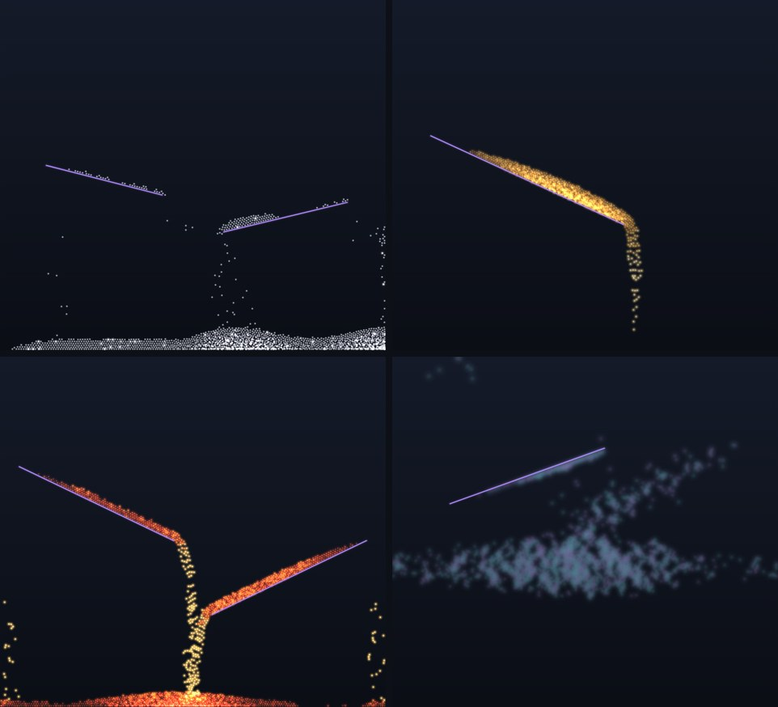
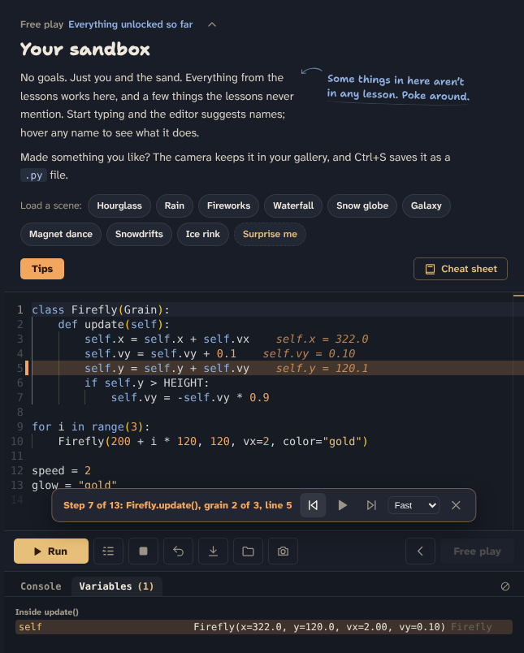
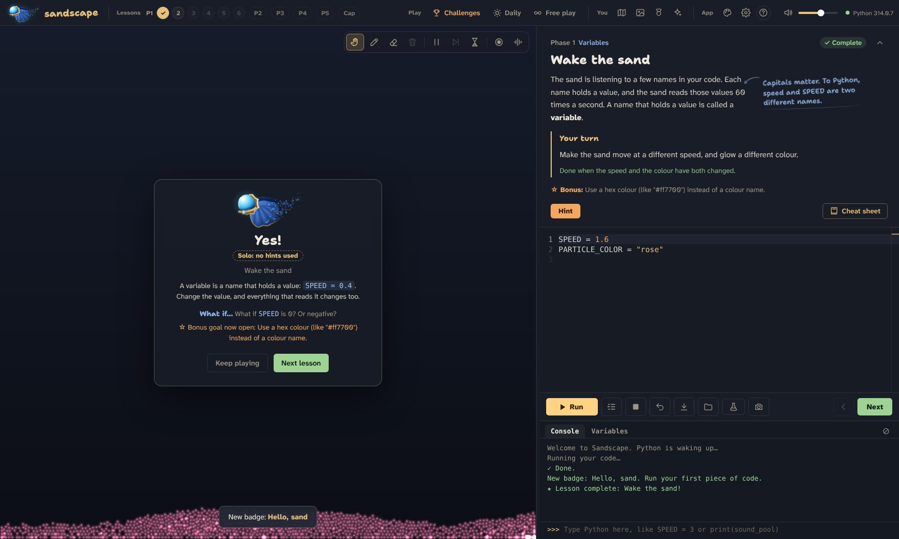

  

<h1 align="center">Sandscape</h1>

  A desktop app that teaches Python by letting you shape glowing, musical sand. 
  <a href="https://github.com/BadrWaqas/sandscape-app/releases/latest"><b>Download for Windows</b></a>

  

## What it is

Most first Python lessons happen in a console: print some text, add two numbers, move on. In Sandscape your code drives a box of a few thousand grains of sand instead. Change `GRAVITY` and the sand floats. Write an `if` and a grain bounces off the walls. Every grain that lands hard plays a note, so a `for` loop can turn into a melody.

It's made for people who have never written code before, and it uses real Python, not a made-up version of it. What you learn carries straight over to anything else you write.

## What's inside

- **29 lessons** across five phases, from variables and `if` to classes, recursion and generators, ending with a project where you build your own instrument
- **Missions that give you the goal, not the steps.** Hints start with a question and only get more specific if you ask for them
- **A quiz at the end of every phase**, 10 challenges with star ratings, and a daily challenge with a streak
- **Step-through mode** that runs your code one line at a time and writes each variable's new value beside the line that changed it
- **Free Play** with nine materials (sand, water, stone, snow, ice, bouncy, honey, lava and smoke), ten instruments and a set of scenes to start from
- **Error messages in plain English**, a cheat sheet with an example for everything, and notes that fill themselves in as you use new things
- **18 hidden discoveries** for anyone who likes to poke at things

## Screenshots

*Phase 2: build a firefly with a class of your own. The note in the margin is a tip, never the answer.*

*Snow, honey, lava and smoke. One line of code changes what the grains are made of, and each has its own physics and sound.*

*Step-through: watch one frame of your code run, line by line.*

*Finishing a lesson: a short recap, a "what if…" to try next, and a bonus goal.*

## How it works

- **Real Python, inside the app.** CPython compiled to WebAssembly (Pyodide) runs in a background worker, so a `while True:` can never freeze the window, and the Stop button can interrupt it.
- **Custom sand physics.** Up to 5,000 grains stored in flat typed arrays, a spatial grid for collisions, 120 physics steps a second, and settled grains that "sleep" so still sand costs nothing.
- **Sound made live.** Every note is synthesised with the Web Audio API and nudged onto a beat (and onto a scale, if you pick one), which is what turns random bounces into something that sounds like music.
- **A proper editor.** Monaco (the editor inside VS Code), with hover help for every Sandscape name.
- **Electron** packages it as a normal Windows app. Your progress is saved on your own computer.

## Download

1. Go to [Releases](https://github.com/BadrWaqas/sandscape-app/releases/latest) and download `Sandscape-Setup-x.x.x.exe`.
2. Run it. Windows may say "Windows protected your PC" because the installer isn't signed: click **More info**, then **Run anyway**.
3. Sandscape opens when it's done, and adds a shortcut to your desktop and Start menu.

Windows 10 or 11, 64-bit. About 115 MB.

## About

Made by [Badr Waqas](https://www.linkedin.com/in/badrw), a Data Science student at National College of Ireland. The source code is private; this repository is home to the app's releases. Feedback and bug reports are very welcome in [Issues](https://github.com/BadrWaqas/sandscape-app/issues).

© 2026 Badr Waqas. All rights reserved.
